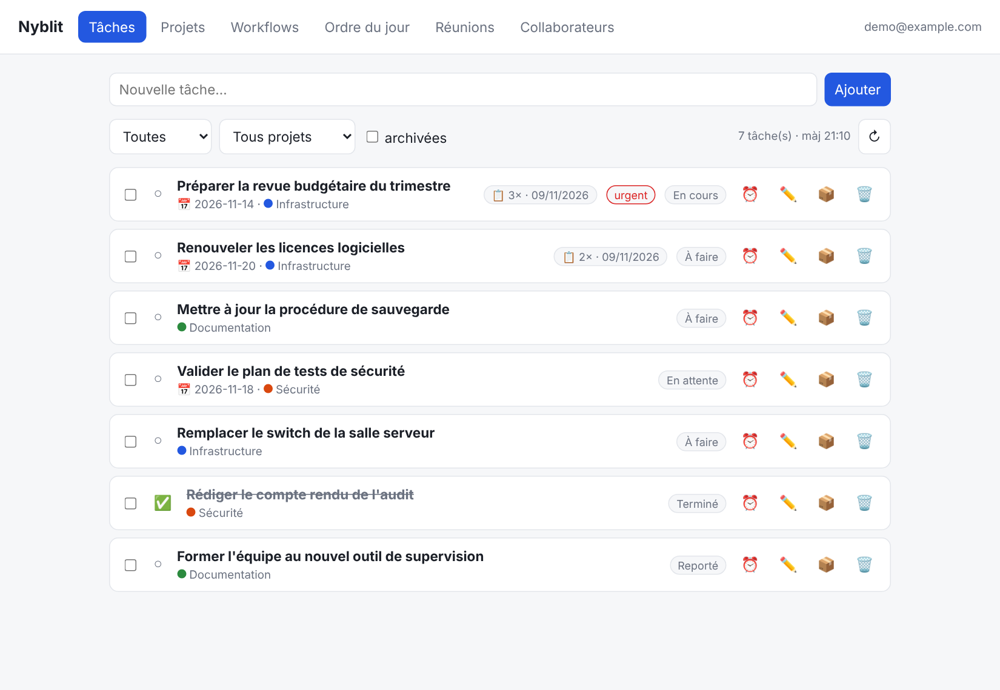
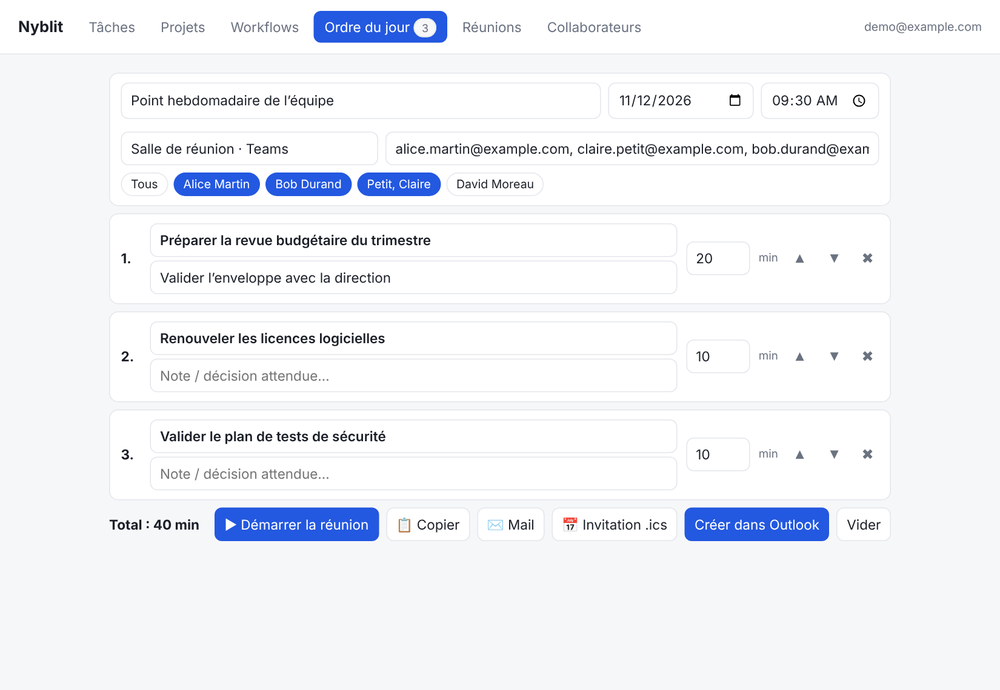
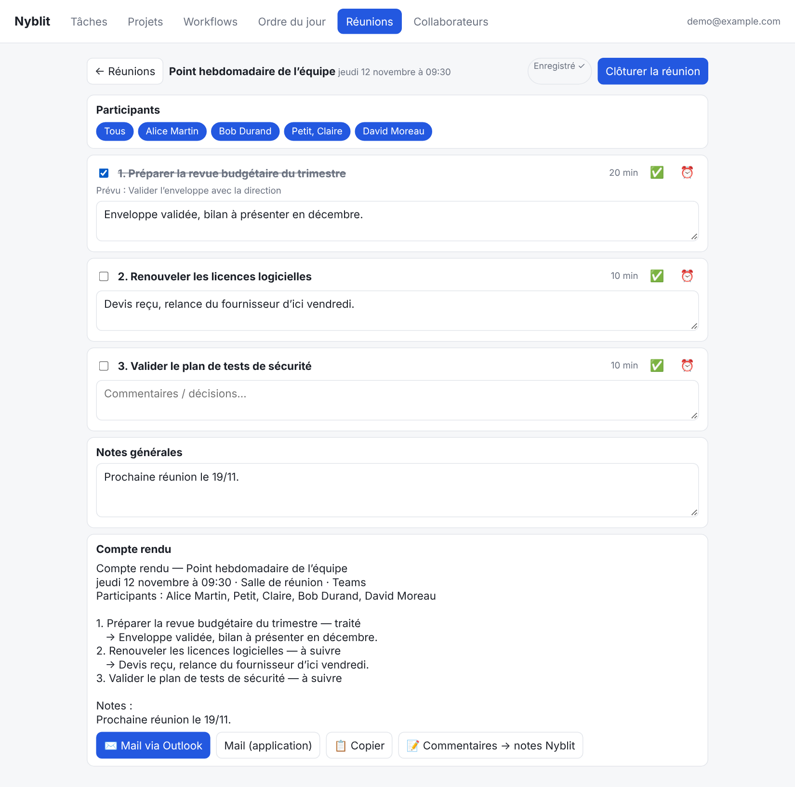
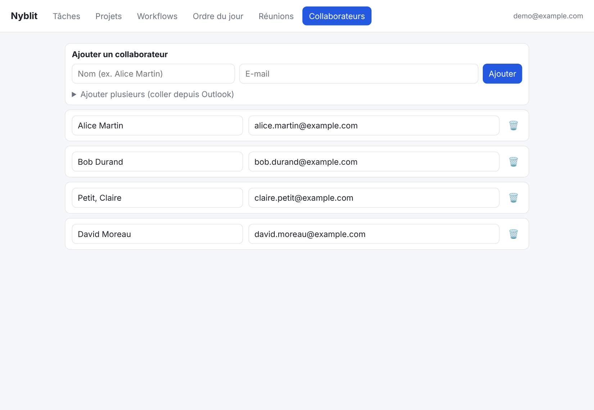

# Nyblit – ordres du jour et réunions / agendas and meetings

🇫🇷 [Français](#-français) · 🇬🇧 [English](#-english)

---

## 🇫🇷 Français

Petite application web (HTML/JS + PHP) qui se connecte à l'[API Nyblit](https://developers.nyblit.app/developers)
pour lister ses tâches, préparer un **ordre du jour**, mener la **réunion** (commentaires par tâche)
et envoyer le **compte rendu** par mail.

### Fonctions
- **Tâches** : liste filtrable (statut, projet, archivées), ajout rapide, terminer / reporter / archiver / modifier / supprimer.
  Actualisation automatique toutes les 10 minutes et bouton ↻.
- **Projets** : création, archivage, suppression. **Workflows** : lecture seule.
- **Ordre du jour** : sélection de tâches, durées, notes, ordre, puis envoi par invitation `.ics`,
  lien Outlook web, mail ou copie du texte.
  Possibilité d'ajouter des **points libres** (sans tâche Nyblit), y compris en pleine réunion.
- **Réunions** : mode « réunion en cours » avec commentaires par point, compte rendu généré en direct,
  envoi par mail.
- **Retour vers Nyblit** : depuis l'interface, les commentaires saisis pendant la réunion sont renvoyés dans les notes
  des tâches (bouton « Commentaires → notes Nyblit », ajoutés à la suite avec la date et le titre de la réunion, sans écraser l'existant).
  Pendant la séance, ✅ termine la tâche, ⏰ la reporte au lendemain 8h, et un sélecteur de date modifie son échéance dans Nyblit.
  La date et l'heure de la réunion sont modifiables dans la vue réunion.
- **Mobile** : interface adaptée à l'iPhone (navigation défilante, lignes de tâches sur deux niveaux, boutons tactiles).
- **Collaborateurs** : annuaire (nom + e-mail, ajout en lot collé depuis Outlook). Dans l'ordre du jour et la réunion,
  on sélectionne les participants en un clic : leurs e-mails sont remplis dans l'invitation, le mail et le compte rendu.
- **Statistiques** : nombre de fois où chaque tâche a été mise dans un ordre du jour.

### Captures d'écran
| Tâches | Ordre du jour |
|---|---|
|  |  |
| **Réunion** | **Collaborateurs** |
|  |  |

_Données fictives._

### Architecture
- `index.html` : interface (un seul fichier).
- `proxy.php` : relaie les appels vers l'API. Le jeton reste côté serveur (pas de CORS, jamais exposé au navigateur).
- `stats.php`, `meetings.php`, `contacts.php` : stockage JSON dans `data/` (statistiques, réunions, collaborateurs).
- `config.php` (non versionné) : jeton et URL de base.

### Installation
Prérequis : un serveur web avec PHP et l'extension cURL (Apache ou nginx + PHP).

1. Copier les fichiers dans un dossier du serveur (ex. `/var/www/html/nyblit`).
2. Copier `config.example.php` en `config.php` et renseigner le jeton Nyblit
   (Mon compte → Accès API). Scopes conseillés : `tasks:read`, `tasks:write`, `projects:read`, `projects:write`, `workflows:read`.
3. Donner les droits d'écriture sur le dossier à l'utilisateur du serveur web (création de `data/`).
4. **Protéger l'accès** (authentification HTTP, réseau local, VPN) : `proxy.php` donne accès au compte Nyblit.

Exemple Apache (authentification de base) :
```apache
<Directory /var/www/html/nyblit>
  AuthType Basic
  AuthName "Nyblit"
  AuthUserFile /etc/apache2/.htpasswd
  Require valid-user
</Directory>
```

### Personnalisation
- `SIGNATURE` en haut du script de `index.html` : signature ajoutée en bas des mails.
- Les participants se saisissent sous forme d'adresses e-mail séparées par des virgules.
- `base_url` dans `config.php` : la documentation indique `https://api.nyblit.app/v1`,
  le fichier OpenAPI `https://developers.nyblit.app/api/v1` ; utiliser celle qui répond.

### Limites
- Les compteurs comptent le clic sur un bouton d'envoi, pas l'envoi réel du mail.
- Application personnelle, sans gestion multi-utilisateurs.
- Servie en `http://`, certaines fonctions du navigateur (presse-papiers, `crypto.randomUUID`) sont limitées : l'application les contourne.

### Licence
MIT, voir [`LICENSE`](LICENSE).

---

## 🇬🇧 English

A small web application (HTML/JS + PHP) that connects to the [Nyblit API](https://developers.nyblit.app/developers)
to list your tasks, prepare a meeting **agenda**, run the **meeting** (per-task comments)
and send the **minutes** by e-mail.

### Features
- **Tasks**: filterable list (status, project, archived), quick add, complete / postpone / archive / edit / delete.
  Automatic refresh every 10 minutes plus a ↻ button.
- **Projects**: create, archive, delete. **Workflows**: read-only.
- **Agenda**: pick tasks, set durations, notes and order, then send it as an `.ics` invitation,
  an Outlook web link, an e-mail, or copy the text.
  You can add **free-form items** (no Nyblit task), including during a meeting.
- **Meetings**: a "meeting in progress" mode with a comment field per item, minutes generated live,
  and e-mail sending.
- **Sync back to Nyblit**: from the UI, comments typed during a meeting are pushed into the Nyblit task notes
  ("Commentaires → notes Nyblit" button, appended with the date and meeting title, never overwriting existing notes).
  During the meeting, ✅ completes the task, ⏰ postpones it to tomorrow 8am, and a date picker changes its due date in Nyblit.
  The meeting date and time can be edited in the meeting view.
- **Mobile**: iPhone-friendly layout (scrollable navigation, two-line task rows, touch-sized buttons).
- **Collaborators**: a directory (name + e-mail, bulk paste from Outlook). On the agenda and in meetings you pick
  attendees with one click: their e-mails are filled into the invitation, the mail and the minutes.
- **Statistics**: how many times each task has been put on an agenda.

### Screenshots
See the gallery above (fake data): tasks, agenda, meeting, collaborators.

### Architecture
- `index.html`: the UI (single file).
- `proxy.php`: forwards calls to the API. The token stays on the server (no CORS issues, never exposed to the browser).
- `stats.php`, `meetings.php`, `contacts.php`: JSON storage in `data/` (statistics, meetings, collaborators).
- `config.php` (not versioned): token and base URL.

### Installation
Requirements: a web server with PHP and the cURL extension (Apache, or nginx + PHP).

1. Copy the files into a folder on the server (e.g. `/var/www/html/nyblit`).
2. Copy `config.example.php` to `config.php` and set your Nyblit token
   (My account → API Access). Recommended scopes: `tasks:read`, `tasks:write`, `projects:read`, `projects:write`, `workflows:read`.
3. Give the web server user write access to the folder (it creates `data/`).
4. **Protect access** (HTTP authentication, local network, VPN): `proxy.php` gives access to your Nyblit account.

Apache example (basic authentication):
```apache
<Directory /var/www/html/nyblit>
  AuthType Basic
  AuthName "Nyblit"
  AuthUserFile /etc/apache2/.htpasswd
  Require valid-user
</Directory>
```

### Customization
- `SIGNATURE` at the top of the script in `index.html`: signature appended to e-mails.
- Attendees are entered as e-mail addresses separated by commas.
- `base_url` in `config.php`: the docs say `https://api.nyblit.app/v1`,
  the OpenAPI file says `https://developers.nyblit.app/api/v1`; use whichever responds.

### Limitations
- Counters record a click on a send button, not whether the e-mail was actually sent.
- Personal application, no multi-user support.
- Served over plain `http://`, some browser features (clipboard, `crypto.randomUUID`) are restricted; the app works around them.

### License
MIT, see [`LICENSE`](LICENSE).
